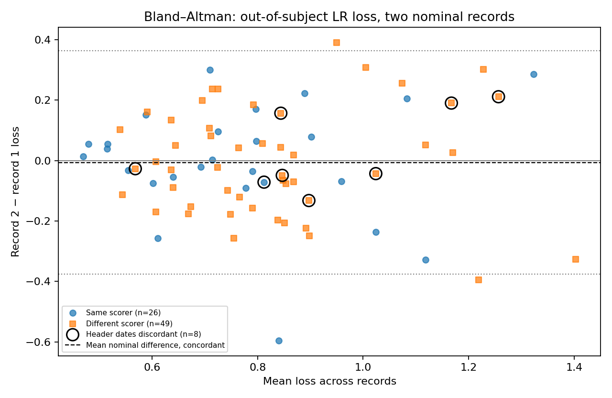

# Subject-Level Generalization and Between-Recording Variability in EEG Sleep Staging

A reproducibility and methodological evaluation study on the Sleep-Cassette (SC)
subset of PhysioNet **Sleep-EDF Expanded v1.0.0**.

**Author and maintainer:** Paola Aguirre

## Research question

The study asks two descriptive questions about a deliberately simple, fixed
single-channel classifier:

1. How well does a fixed spectral sleep-stage classifier perform on a subject
   it has never seen (Leave-One-Subject-Out, LOSO), and how much does that
   performance vary between subjects?
2. For subjects with two recordings, how large is the difference in
   out-of-subject predictive loss between the two recordings of the same
   person, relative to the spread between people?

Unlike sleep-stage classification benchmarks focused on model optimization,
this study uses a fixed, deliberately simple classifier to examine
subject-level generalization and between-recording variability in predictive
loss. It additionally documents scorer-related annotation differences,
recording-date inconsistencies, and sensitivity to loss aggregation.

This study is a methodological evaluation, not a competitive sleep-staging
benchmark or clinical validation. Related work is cited below; the emphasis
is on subject-level generalization, between-recording variability, and
transparent reporting.

---

## Main results

| Quantity | Value |
|---|---|
| Subjects / Sleep-Cassette recordings | 78 / 153 |
| Analysed 30-s EEG epochs (main-sleep window) | 161,028 |
| Input | Fpz–Cz EEG, 10 Welch spectral features per epoch |
| Validation | Leave-One-Subject-Out (78 folds) |
| **Mean subject-level macro-F1, Logistic Regression** | **0.5448** |
| **Mean subject-level macro-F1, Dummy (class prior)** | **0.1198** |
| Subjects with two recordings (paired) | 75 |
| Median absolute paired difference in LR mean log-loss, \|record 2 − record 1\| (orientation-invariant) | ≈ 0.1121 |
| Pairs annotated by different scorers | 49 of 75 |
| Pairs with discordant EDF header dates | 8 of 75 |

Subject-level macro-F1 is computed per subject over the stages that are present
in that subject's reference labels, then averaged with equal weight per subject
(definition in [`report/METHODS.md`](report/METHODS.md#5-performance-metrics)).
The Dummy classifier provides a prevalence-based reference baseline.

Additional descriptive quantities (median, IQR, subject-resampled bootstrap
intervals, sensitivity definitions of macro-F1, stratified paired summaries) are
in [`results/loso_summary.json`](results/loso_summary.json) and
[`results/night_pair_summary.json`](results/night_pair_summary.json). All
bootstrap intervals are descriptive and conditional on the trained models; no
hypothesis tests are reported.

The paired summary (schema 2.0) separates three kinds of statistic:
orientation-invariant values over all 75 pairs, nominal-orientation diagnostics
that depend on the file-name night order, and chronological signed values
restricted to the 67 date-concordant pairs. See
[`report/RESULTS_SCHEMA.md`](report/RESULTS_SCHEMA.md).

Verification status of each result is listed in
[`report/VERIFICATION.md`](report/VERIFICATION.md). An independent numerical
audit recomputed the reported statistics from the saved out-of-fold
predictions (9,190 values, all within tolerance). It did not re-run the
pipeline from the raw EDF recordings.



---

## Pipeline

```
Sleep-EDF Expanded ZIP (downloaded separately, never extracted in full)
  └─ 1. Manifest + integrity audit        build_sleep_edf_manifest.py
  └─ 2. Annotation-alignment checks       sleep_edf_two_night_smoke.py (optional)
                                          audit_sleep_edf_epoch_alignment.py
  └─ 3. Main-sleep window audit           audit_sleep_edf_windows_v1_2.py
  └─ 4. Spectral features                 extract_sleep_edf_pilot_v1_2_fixed.py (1-subject pilot)
                                          extract_sleep_edf_all_v1_2.py (all 153 records)
  └─ 5. Pre-model QA                      validate_sleep_edf_features_v1_2.py
  └─ 6. LOSO LR vs Dummy + metrics        run_sleep_edf_loso_v1_2.py
  └─ 7. Paired-recording analysis         analyze_sleep_edf_night_pairs_v1_2.py
       7b. Relabel summary to schema 2.0  restructure_night_pair_summary.py (no arithmetic)
```

All analysis parameters (channel, epoching, label map, window rule, Welch
settings, bands, model hyperparameters, bootstrap seed `20261111`) are fixed in
[`config/study_v1_2.yaml`](config/study_v1_2.yaml). There is no hyperparameter
search. Full methodological detail: [`report/METHODS.md`](report/METHODS.md).

---

## Repository layout

```
.
├── README.md
├── DATA_AND_ATTRIBUTION.md      dataset licence, required citations, third-party software
├── LICENSE                      MIT licence for the original code
├── environment.yml
├── config/
│   └── study_v1_2.yaml          frozen analysis configuration
├── src/                         analysis scripts (run as standalone CLI scripts)
├── tests/                       synthetic-data tests (no real EEG used)
├── results/                     committed reference results (not written by reproduction runs)
│   ├── loso_summary.json        aggregate LOSO results
│   ├── night_pair_summary.json  aggregate paired-recording results
│   ├── audit_summary.json       dataset inventory audit
│   ├── window_audit_summary.json
│   └── figures/
├── report/
│   ├── METHODS.md
│   ├── RESULTS_SCHEMA.md
│   └── VERIFICATION.md
└── work/                        reproduction outputs (created locally; Git-ignored)
```

The scripts in `src/` keep their original file names. They import each other
as sibling modules, so they are run as `python src/<script>.py` from the
repository root. Changes made while preparing this repository are listed in
[`report/VERIFICATION.md`](report/VERIFICATION.md#changes-made-during-repository-preparation).

---

## Reproducing the analysis

### 1. Obtain the data

Download **Sleep-EDF Database Expanded v1.0.0** from PhysioNet
(<https://doi.org/10.13026/C2X676>) as the single ZIP archive
`sleep-edfx-1.0.0.zip` (≈ 8.1 GiB). The archive is read in place; it does not
need to be unpacked. Store it outside this repository. No data files are
distributed here.

### 2. Create the environment

```bash
conda env create -f environment.yml
conda activate sleep-stage-reliability
```

The original results were produced with Python 3.13.12, MNE 1.13.2,
NumPy 2.4.4, SciPy 1.17.1, scikit-learn 1.8.0, pandas 3.0.2, PyYAML 6.0.3,
matplotlib 3.10.8 and threadpoolctl 3.6.0 on macOS (ARM64).

> **Note:** `environment.yml` records these versions but has **not yet been
> independently reproduced** (it has not been solved or installed from
> scratch). If conda cannot resolve an exact pin on your platform, install the
> nearest available version and report the versions you used.

### 3. Run the pipeline

Set the location of the ZIP once (any path on your machine):

```bash
export SLEEP_EDF_ZIP=/path/to/sleep-edfx-1.0.0.zip
```

All commands are run from the repository root. Every reproduction stage reads
from and writes to a separate `work/` directory, which is excluded from version
control by `.gitignore`. The committed reference results in `results/` are
never used as inputs or outputs by these commands, so they cannot be
overwritten by a reproduction run.

```bash
mkdir -p work

# 1. Manifest, pair audit and dataset audit, with streaming SHA-256 verification
python src/build_sleep_edf_manifest.py --zip "$SLEEP_EDF_ZIP" --out work --verify-hashes

# 2a. Optional smoke test of two recordings of one subject
python src/sleep_edf_two_night_smoke.py --zip "$SLEEP_EDF_ZIP" --manifest work/manifest_inventory.csv --subject 00 --out work

# 2b. Annotation-to-epoch alignment audit for subject 00
python src/audit_sleep_edf_epoch_alignment.py --zip "$SLEEP_EDF_ZIP" --manifest work/manifest_inventory.csv --subject 00 --out work

# 3. Label-only main-sleep window audit, all 153 records
python src/audit_sleep_edf_windows_v1_2.py --zip "$SLEEP_EDF_ZIP" --manifest work/manifest_inventory.csv --config config/study_v1_2.yaml --out work

# 4a. Feature pilot on subject 00 (reference for step 4b)
python src/extract_sleep_edf_pilot_v1_2_fixed.py --zip "$SLEEP_EDF_ZIP" --manifest work/manifest_inventory.csv --config config/study_v1_2.yaml --subject 00 --out work

# 4b. Feature extraction for all 153 records (resumable; re-run the same command after interruption)
python src/extract_sleep_edf_all_v1_2.py \
  --zip "$SLEEP_EDF_ZIP" \
  --manifest work/manifest_inventory.csv \
  --window-audit work/window_audit_all_153.csv \
  --window-summary work/window_audit_summary.json \
  --config config/study_v1_2.yaml \
  --out work/features_v1_2 \
  --pilot-csv work/pilot_features_subject00.csv

# 5. Pre-model QA (no model training)
python src/validate_sleep_edf_features_v1_2.py \
  --features work/features_v1_2/features_all_153.csv \
  --audit work/features_v1_2/features_all_153_audit.json \
  --manifest work/manifest_inventory.csv \
  --window-audit work/window_audit_all_153.csv \
  --config config/study_v1_2.yaml \
  --out work/features_v1_2/pre_model_QA_v1_2.json

# 6. LOSO evaluation (models are fitted only with --run)
python src/run_sleep_edf_loso_v1_2.py \
  --features work/features_v1_2/features_all_153.csv \
  --qa work/features_v1_2/pre_model_QA_v1_2.json \
  --config config/study_v1_2.yaml \
  --out work/loso_v1_2 \
  --run

# 7. Paired-recording analysis (no retraining)
python src/analyze_sleep_edf_night_pairs_v1_2.py \
  --oof work/loso_v1_2/published/oof_predictions.csv \
  --loso-summary work/loso_v1_2/published/loso_summary.json \
  --pair-audit work/pair_audit.csv \
  --window-audit work/window_audit_all_153.csv \
  --config config/study_v1_2.yaml \
  --out work/night_pairs_v1_2

# 7b. Relabel the paired summary into schema 2.0 (moves and renames fields only)
python src/restructure_night_pair_summary.py \
  --in work/night_pairs_v1_2/night_pair_summary.json \
  --out work/night_pair_summary.json
```

Each stage verifies the SHA-256 of its inputs (configuration, manifest, window
audit, feature matrix, QA report) and stops on any mismatch, so all stages must
be run with the same `config/study_v1_2.yaml`. Feature extraction streams one
recording at a time to a temporary directory and requires roughly 0.6 GiB of
free scratch space.

**Overwrite behaviour differs between stages:**

| Stage | Behaviour if its outputs already exist |
|---|---|
| 1, 2a, 2b, 3, 4a | No protection: the output files are **overwritten silently**. |
| 4b | Resumable. Completed record folders are verified and skipped. An incomplete record folder stops the run, and so does an existing combined matrix that does not match a new aggregation. Nothing is overwritten automatically. |
| 5 | Refuses to run if the QA output file already exists. |
| 6 | Resumable. Saved per-subject checkpoints are verified and reused. An existing `published/` folder is left unchanged if its recorded input hashes match the current inputs; otherwise the run stops. |
| 7 | Refuses to run if the output folder already exists. Its parent folder must exist. |
| 7b | Refuses to run if the output file already exists, or if the input is not a schema-1.0 summary. |

To start a reproduction from scratch, delete `work/` or use a new folder in its
place. The usage examples inside the script docstrings still show an older
`results/` layout; the commands above are the ones to use.

**Expected outcome.** A reproduction writes its outputs to `work/`. The key
files can be compared with the committed reference results:

| Reproduced output | Committed reference |
|---|---|
| `work/audit_summary.json` | `results/audit_summary.json` |
| `work/window_audit_summary.json` | `results/window_audit_summary.json` |
| `work/loso_v1_2/published/loso_summary.json` | `results/loso_summary.json` |
| `work/night_pair_summary.json` (schema 2.0, from step 7b) | `results/night_pair_summary.json` (schema 2.0) |
| `work/night_pairs_v1_2/figures/*.png` | `results/figures/*.png` |

The numerical values should agree. The provenance hashes recorded inside the
JSON files will differ for `config_sha256` and for the hashes that depend on
it, because the configuration file was edited (comments only) for
publication; see
[`report/VERIFICATION.md`](report/VERIFICATION.md#provenance-hashes). The
schema-1.0 output of step 7 (`work/night_pairs_v1_2/night_pair_summary.json`)
has the layout of the audited historical output; step 7b relabels it.

### 4. Tests

```bash
python -m pytest tests
```

The tests use synthetic fixtures only and do not require the dataset. They
cover the feature-extraction orchestration (resume and integrity guards), not
the numerical results.

---

## Limitations

- **Dataset and model scope.** This study evaluates a fixed, single-channel spectral classifier on the Sleep-EDF Sleep-Cassette cohort. Generalization to other populations, devices and scoring standards was not assessed.
- **Retrospective evaluation window.** The main-sleep window is derived from reference annotations and excludes 4,140 sleep epochs outside the selected main episode. Results describe performance within this window, not a real-time deployment scenario.
- **Paired-recording interpretation.** Each of the 75 paired subjects contributes two recordings. Differences in predictive loss may reflect physiology, annotation practices, sleep-stage composition and recording artifacts. The study cannot isolate their contributions. Forty-nine pairs were annotated by different scorers.
- **Recording chronology.** Eight pairs have discordant recording dates. Absolute differences use all 75 pairs; chronological signed summaries use the 67 date-concordant pairs. Nominal-order diagnostics are reported separately. The RMS-based within-pair scale includes any systematic session bias.
- **Uncertainty and verification.** LOSO training sets overlap, and bootstrap intervals are conditional on the fitted models. Independent verification reproduced numerical results from saved out-of-fold predictions, but did not independently reproduce raw-data processing, feature extraction or model fitting, or establish the absence of upstream leakage. The computational environment has not been independently reproduced.
- **Protocol status.** The study used a versioned internal protocol that was not externally preregistered.

---

## Related work

- **SLEEPYLAND** (Dei Rossi et al., 2026): reports per-recording performance
  distributions with Sleep-Cassette among the external sets.
- Shih, Lv, Zhai & Xu (2026): physiology-informed spectral–temporal learning
  with confidence-aware evaluation for single-channel EEG sleep staging.

No numerical comparison with these works is made; differences in channels,
windows, label handling and metrics make such comparisons misleading.

## Citation

If you use this code, please cite this repository and the dataset:

```
Aguirre, P. Subject-Level Generalization and Between-Recording Variability in
EEG Sleep Staging. GitHub repository: koalaresearch/sleep-stage-reliability.
```

Dataset, original publication and PhysioNet citations are listed in
[`DATA_AND_ATTRIBUTION.md`](DATA_AND_ATTRIBUTION.md).

### References

1. Kemp B, Zwinderman AH, Tuk B, Kamphuisen HAC, Oberyé JJL. Analysis of a
   sleep-dependent neuronal feedback loop: the slow-wave microcontinuity of the
   EEG. *IEEE Trans Biomed Eng.* 2000;47(9):1185–1194.
2. Kemp B. Sleep-EDF Database Expanded (version 1.0.0). PhysioNet.
   <https://doi.org/10.13026/C2X676>
3. Pollard T, Moody BE, Lehman L, et al. PhysioNet as a global platform for
   biomedical research. *Nature Health.* 2026;1(8):792–795.
   <https://doi.org/10.1038/s44360-026-00096-z>
4. Bland JM, Altman DG. Measurement error. *BMJ.* 1996;313:744.
5. Collins GS, et al. TRIPOD+AI statement. *BMJ.* 2024;385:e078378.
6. Dei Rossi A, Metaldi M, Bechny M, Filchenko I, van der Meer J, Schmidt MH,
   Bassetti CLA, Tzovara A, Faraci FD, Fiorillo L. SLEEPYLAND: trust begins
   with fair evaluation of automatic sleep staging models.
   *npj Digital Medicine.* 2026;9:55.
   <https://doi.org/10.1038/s41746-025-02237-2>
7. Shih, Lv, Zhai, Xu. *Frontiers in Signal Processing.* 2026.
   <https://doi.org/10.3389/frsip.2026.1956948>
8. Gramfort A, et al. MEG and EEG data analysis with MNE-Python.
   *Front Neurosci.* 2013;7:267.
9. Pedregosa F, et al. Scikit-learn: Machine Learning in Python.
   *JMLR.* 2011;12:2825–2830.

## Licence

The original code is released under the MIT License, copyright (c) 2026
Paola Aguirre; see [`LICENSE`](LICENSE).
The Sleep-EDF data are **not** included and remain under their own licence
(Open Data Commons Attribution License v1.0); see
[`DATA_AND_ATTRIBUTION.md`](DATA_AND_ATTRIBUTION.md).
